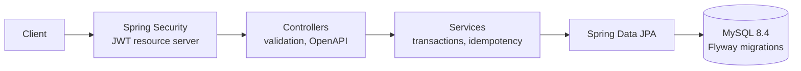

# Shop API

REST API bán hàng với sản phẩm, đơn hàng, tồn kho và bảo mật JWT. Dự án tổng hợp của khóa học Java Backend: JDBC, Servlet, Hibernate và Spring, được viết để đọc, chạy và kiểm thử được từ đầu đến cuối.

## Tính năng

* Đăng ký, đăng nhập, phát hành JWT (HS256) có vai trò `CUSTOMER` hoặc `ADMIN`.
* Danh mục sản phẩm công khai: tìm theo tên, phân trang; quản trị viên tạo, sửa, ngừng bán.
* Đặt hàng nhiều dòng trong một giao dịch: trừ kho nguyên tử, hoàn tác trọn gói khi một dòng thiếu hàng, hủy đơn trả lại kho.
* Đặt hàng idempotent bằng header `Idempotency-Key`: gửi lại cùng một yêu cầu không tạo đơn thứ hai.
* Lỗi theo chuẩn RFC 9457 (`application/problem+json`) với mã lỗi ổn định (`code`).
* Tài liệu OpenAPI và Swagger UI, kiểm tra sức khỏe qua Actuator.
* Lược đồ cơ sở dữ liệu quản lý bằng Flyway, Hibernate chỉ kiểm tra (`ddl-auto=validate`).

## Kiến trúc



Một ứng dụng Spring Boot duy nhất (modular monolith) chia theo miền: `auth`, `user`, `product`, `order`, cộng `config`, `error`, `common`. Mỗi miền có controller, service và repository riêng; chỉ `order` phụ thuộc `product` và `user`.

## Công nghệ

Java 17, Spring Boot 4.1.1, Spring Security 7 (resource server, Nimbus JOSE), Spring Data JPA và Hibernate, Flyway, MySQL 8.4, springdoc-openapi 3.1.1, JUnit 6, Mockito, Testcontainers, Docker Compose.

## Yêu cầu môi trường

| Thành phần | Phiên bản đã kiểm chứng | Ghi chú |
|---|---|---|
| JDK | 17 trở lên | `java -version` |
| Maven | 3.9 trở lên | `mvn -v` |
| Docker Engine | 23 trở lên | cần cho chạy bằng Compose và cho bộ test (Testcontainers) |
| Docker Compose | 2.17 trở lên | `docker compose version` |

## Chạy nhanh bằng Docker Compose

```bash
cp .env.example .env
mvn -DskipTests package
docker compose up -d --build --wait
bash scripts/smoke.sh
```

Sửa `.env` trước khi dùng thật: `DB_PASSWORD`, `DB_ROOT_PASSWORD`, `JWT_SECRET` (ít nhất 32 byte), `ADMIN_EMAIL`, `ADMIN_PASSWORD`. Đặt `SPRING_PROFILES_ACTIVE=dev` để nạp ba sản phẩm mẫu (`db/dev`). Ứng dụng nghe ở `http://localhost:8080` (đổi bằng `APP_PORT`), tài liệu API ở `/swagger-ui.html`.

## Cấu hình

| Biến môi trường | Ý nghĩa | Mặc định |
|---|---|---|
| `DB_URL`, `DB_USER`, `DB_PASSWORD` | Kết nối MySQL | `jdbc:mysql://localhost:3306/shop`, `shop`, `shop_pw` |
| `JWT_SECRET` | Khóa ký HS256, tối thiểu 32 byte; thiếu hoặc ngắn thì ứng dụng không khởi động | không có |
| `JWT_TTL` | Thời hạn token (ISO-8601); hiệu lực thực tế dài hơn 60 giây do dung sai đồng hồ | `PT1H` |
| `ADMIN_EMAIL`, `ADMIN_PASSWORD` | Tạo tài khoản quản trị lúc khởi động nếu chưa có | trống (không tạo) |

## API tổng quan

| Phương thức và đường dẫn | Quyền | Mô tả |
|---|---|---|
| `POST /api/auth/register` | công khai | Tạo tài khoản `CUSTOMER` |
| `POST /api/auth/login` | công khai | Trả về `token` |
| `GET /api/products`, `GET /api/products/{id}` | công khai | Tìm và đọc sản phẩm đang bán |
| `POST`, `PUT`, `DELETE /api/products...` | `ADMIN` | Tạo, sửa, ngừng bán |
| `POST /api/orders` | đăng nhập | Đặt hàng (header `Idempotency-Key` tùy chọn) |
| `GET /api/orders`, `GET /api/orders/{id}` | đăng nhập | Đơn của tôi; quản trị viên đọc được mọi đơn |
| `POST /api/orders/{id}/cancel` | đăng nhập | Hủy đơn còn `CREATED`, trả lại kho |

Ví dụ:

```bash
TOKEN=$(curl -s -X POST localhost:8080/api/auth/login -H 'Content-Type: application/json' \
  -d '{"email":"admin@example.com","password":"change-me-admin"}' | python3 -c "import json,sys;print(json.load(sys.stdin)['token'])")
curl -s -X POST localhost:8080/api/orders -H "Authorization: Bearer $TOKEN" -H 'Idempotency-Key: order-1' \
  -H 'Content-Type: application/json' -d '{"lines":[{"productId":1,"quantity":2}]}'
```

## Cấu trúc

```text
shop-api/
  pom.xml
  Dockerfile                    image nhiều tầng, chạy bằng người dùng không phải root
  docker-compose.yml            MySQL và API, healthcheck, giới hạn bộ nhớ
  .env.example                  mẫu biến môi trường
  .github/workflows/ci.yml      build, test, dựng image
  scripts/smoke.sh              kịch bản kiểm tra nhanh bằng curl
  docs/                         kiến trúc, hướng dẫn triển khai, câu hỏi phỏng vấn
  src/main/java/dev/canhdominich/shop/
    ShopApplication.java
    config/                     SecurityConfig, JwtProperties, OpenApiConfig
    auth/                       đăng ký, đăng nhập, phát hành token
    user/                       User, UserRole, UserRepository
    product/                    Product, ProductRepository, ProductService, ProductController, DTO
    order/                      Order, OrderLine, OrderPlacement, OrderService, OrderController, DTO
    error/                      ApiExceptionHandler, NotFoundException, ConflictException
    common/                     PageResponse
    bootstrap/                  AdminInitializer
  src/main/resources/
    application.yml
    db/migration/V1__schema.sql
    db/dev/V100__demo_products.sql
  src/test/java/dev/canhdominich/shop/   34 test
```

## Kiểm thử

```bash
mvn verify
```

Cần Docker vì mọi test tích hợp chạy trên MySQL 8.4 thật bằng Testcontainers. Bộ test gồm 34 test: luồng nghiệp vụ, quy tắc bảo mật, kiểm tra dữ liệu và định dạng lỗi, idempotency, đồng thời (20 người mua một mặt hàng còn 10), và repository trên cơ sở dữ liệu thật.

## Lỗi thường gặp khi chạy lab

| Triệu chứng | Nguyên nhân | Cách xử lý |
|---|---|---|
| `docker compose up` báo `set JWT_SECRET in .env` | Thiếu biến bắt buộc trong `.env` | Sao chép `.env.example` thành `.env` và điền giá trị |
| Dịch vụ `api` thoát với `app.jwt.secret ... must be at least 32 bytes long` | `JWT_SECRET` thiếu hoặc ngắn | Đặt chuỗi ngẫu nhiên từ 32 byte trở lên |
| `port is already allocated` | Cổng 8080 đã bị dùng | Đặt `APP_PORT` khác trong `.env` |
| `mvn verify` lỗi kết nối Docker | Docker chưa chạy hoặc thiếu quyền | Chạy Docker rồi thử `docker ps` |
| Mọi yêu cầu có token đều `401` | Token hết hạn (mặc định 1 giờ) hoặc `JWT_SECRET` đã đổi | Đăng nhập lại |

## Quyết định thiết kế

* **Trừ kho bằng một câu `UPDATE` có điều kiện** (`where stock >= :quantity`) thay vì đọc rồi ghi, để đúng khi có nhiều yêu cầu đồng thời.
* **Ràng buộc `CHECK (stock >= 0)` ở cơ sở dữ liệu** là lưới an toàn cuối cùng cho tính đúng của tồn kho.
* **Idempotency bằng ràng buộc duy nhất `(user_id, idempotency_key)`**: yêu cầu thua cuộc đua nhận lại đơn đã tạo thay vì lỗi.
* **Trả `404` thay vì `403`** khi người dùng đọc đơn của người khác, để không lộ đơn đó có tồn tại.
* **Thông báo đăng nhập sai giống nhau** cho email không tồn tại và mật khẩu sai.
* **Flyway quản lý lược đồ**, Hibernate chỉ `validate`: lược đồ lệch với thực thể làm ứng dụng không khởi động.

## Hạn chế đã biết

* Token không thu hồi được trước hạn (không có danh sách thu hồi hay refresh token); và thời hạn hiệu lực thực tế là `JWT_TTL` cộng khoảng lệch đồng hồ mặc định 60 giây của Spring Security.
* Chưa có thanh toán, vận chuyển, và trạng thái đơn chỉ gồm `CREATED` và `CANCELLED`.
* Chưa giới hạn tốc độ gọi API và chưa có HTTPS: đặt sau một reverse proxy khi triển khai.
* CI chưa được chạy trên GitHub trong bản này; tệp `ci.yml` là mẫu.

## Giấy phép

Chưa chọn giấy phép; mã nguồn dùng để học tập.
