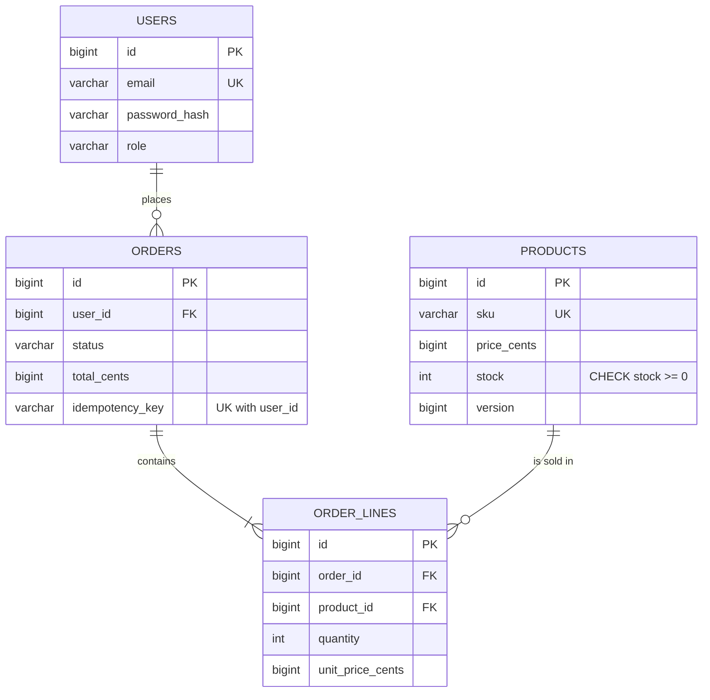
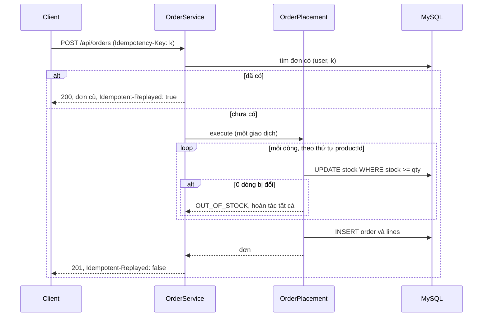

# Kiến trúc Shop API

## Yêu cầu nghiệp vụ

| Mã | Yêu cầu | Cách đáp ứng |
|---|---|---|
| R1 | Khách xem danh mục mà không cần đăng nhập | `GET /api/products` công khai, phân trang, giới hạn 100 mục mỗi trang |
| R2 | Chỉ quản trị viên thay đổi danh mục | Quy tắc `hasRole("ADMIN")` trên `/api/products` cho mọi phương thức khác `GET` |
| R3 | Khách đặt hàng nhiều dòng, tất cả hoặc không dòng nào | Một giao dịch trong `OrderPlacement.execute`; thiếu hàng ở dòng nào thì hoàn tác mọi dòng |
| R4 | Không bán quá số lượng tồn kho dù nhiều người mua cùng lúc | `UPDATE ... WHERE stock >= :quantity` và `CHECK (stock >= 0)` |
| R5 | Gửi lại yêu cầu đặt hàng do mạng lỗi không tạo đơn thứ hai | Header `Idempotency-Key` và ràng buộc duy nhất `(user_id, idempotency_key)` |
| R6 | Khách chỉ thấy đơn của mình | Truy vấn theo `user_id`; đọc đơn người khác trả `404` |
| R7 | Lỗi rõ ràng, máy đọc được | `application/problem+json` với `code` ổn định |

## Lược đồ cơ sở dữ liệu

Tiền được lưu bằng số nguyên theo đơn vị nhỏ nhất (`*_cents`) để tránh sai số số thực. Đơn giá được chép vào `order_lines.unit_price_cents` lúc đặt hàng, nên đổi giá sản phẩm sau đó không làm đổi đơn cũ.

## Đặt hàng

Các dòng được xử lý theo thứ tự `productId` để hai đơn cùng chạm nhiều sản phẩm khóa các hàng theo cùng một thứ tự, tránh khóa chết (deadlock).

## Ranh giới và phụ thuộc

* `OrderService` không có `@Transactional` ở phương thức đặt hàng: nó gọi `OrderPlacement` (bean riêng, có `@Transactional`) để một xung đột khóa duy nhất xảy ra sau khi giao dịch đã kết thúc và có thể được xử lý (đọc lại đơn đã tạo).
* Controller không bao giờ trả thực thể JPA; mọi phản hồi là `record` DTO.
* Phân trang trả `PageResponse` (cấu trúc ổn định do dự án quy định) thay vì `Page` của Spring.
